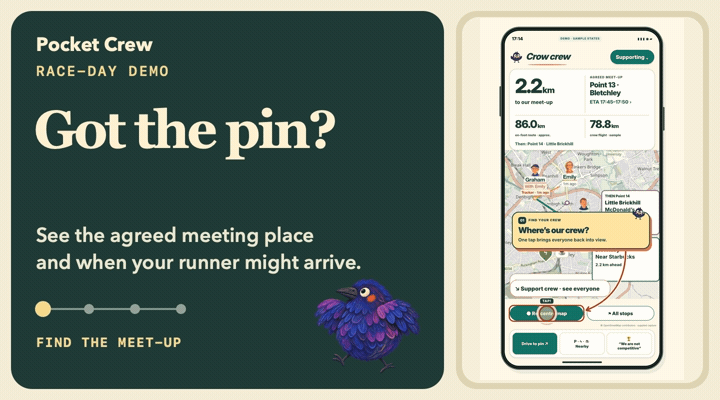

<h1 align="center">Pocket Crew</h1>
<p align="center"><strong>A phone-first guide for ultrarunners and the crew bringing the spare socks.</strong></p>
<p align="center">
  <a href="https://pocketcrew.run/"><strong>Open the Meriden guide</strong></a> ·
  <a href="demo/renders/Pocket-Crew-Playful-Phone-Demo.mp4">Watch the full 65-second walkthrough</a>
</p>
<p align="center">
  <a href="demo/renders/Pocket-Crew-Playful-Phone-Demo.mp4"></a>
</p>
<p align="center"><sub>A 16-second loop from the sample race-day walkthrough.</sub></p>

## “Where are we meeting again?”

At 2 am, the tracker has a dot, the route has a pin and the group chat has three versions of the plan. Pocket Crew brings the **agreed meet-up**, **estimated arrival window** and **nearby essentials** onto one map. The runner gets the big-text version. The crew can check the plan before putting the kettle on.

We built it for Emily and Jeff’s **Escape from Meriden**, where runners choose their own routes and crews arrange their own meet-ups. [Explore the event](https://www.escapefrommeriden.co.uk/)

| Stage | What to try |
| --- | --- |
| [**Before**](https://pocketcrew.run/before) | Browse the planned route, meeting points and kit checklist. |
| [**During**](https://pocketcrew.run/crew) | Open the next meet-up, check how recently the tracker reported, and find nearby loos, coffee, parking and charging. Crew members with access can mark a stop met or skipped. |
| [**After**](https://pocketcrew.run/) | Play Emily’s illustrated GPS replay, see crew photos and milestone posters, and browse the saved podium and category rankings. This is where the Meriden guide opens today. |

## For race organisers

This is a worked example you can drop into your pre-race notes for entrants bringing a crew. It shows how one family planned their stops around the event tracker and saved the story afterward.

> **Bringing a crew?** See how Emily and Jeff’s crew planned their Escape, from the first meet-up to the last cheer. [Open Pocket Crew](https://pocketcrew.run/)

For another race, start with a crew’s planned route, suitable meeting places and an event-approved tracker source. Recheck facility access and hours, set up separate crew sharing, and use artwork you have permission to share. [Adapt the guide for another crew](docs/reusing-the-guide.md)

## Build a guide for your crew

- [Install the Codex skill](skills/README.md) to work through event setup, race-day support and archiving.
- [Try the interactive demo](demo/README.md) to practise with sample data without a tracker account.
- [Explore the development notes](docs/guide-development.md) for the app, offline saving and the poster layout.

<details>
<summary>Run locally and find the source</summary>

Requires Node.js 22.13 or later.

```sh
git clone https://github.com/wan-huiyan/pocket-crew.git
cd pocket-crew
npm run install:ci
npm run dev
```

Open the local URL printed by the dev server. Shared crew features require a local D1 database and crew configuration. [Setup and reuse notes](docs/reusing-the-guide.md)

| Folder | What’s inside |
| --- | --- |
| `guide/`, `public/` | Guide templates, browser code, route data and artwork |
| `app/api/`, `lib/`, `db/`, `drizzle/` | Tracker adapters, crew sharing, estimates and database schema |
| `demo/`, `skills/` | Editable walkthrough and installable guide-building skill |
| `scripts/`, `tests/`, `archive/` | Build tools, verification sources and historical race inputs |

</details>

<details>
<summary>Tracker data, credit and permissions</summary>

Arrival windows are estimates. Phone location sharing starts when someone turns it on. The replay uses saved GPS and crew check-ins, and the podium uses an archived tracker snapshot. Meriden’s rankings measure crow-flight distance from the start. The replay also shows distance along the sampled GPS path.

Made for Emily, Jeff and their Meriden crew. The source repository is public and has no blanket reuse licence. Family artwork, portraits and third-party event or map data retain their respective rights. The guide shows map and routing attribution, and bundled vendor notices remain with their files. Please check permissions before republishing the example materials.

</details>
