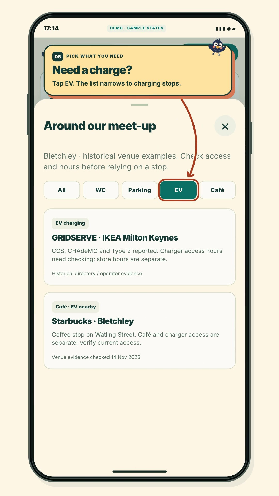

# Pocket Crew 🐦

A little home for runners and their very enthusiastic crew.

A phone-first ultramarathon companion with a route map, meet-up planning, explicit phone location sharing, useful stops, milestone surprises and a post-race replay. Built for Emily and Jeff’s Escape from Meriden.

**[Open the public guide](https://emily-jeff-meriden-crew.whylaura413.chatgpt.site/)** · [Development notes](docs/guide-development.md) · [Adapt it for your crew](docs/reusing-the-guide.md)

<a href="demo/renders/Pocket-Crew-Playful-Phone-Demo.mp4"></a>

**[▶ Watch the 65-second demo](demo/renders/Pocket-Crew-Playful-Phone-Demo.mp4)** · [Try or edit the interactive demo](demo/README.md)

The walkthrough uses labelled sample states and original family-guide artwork to show the features in action. Download or clone the repo and open `demo/index.html` to try it.

## What’s here

- **Runner view:** a readable next meet-up, route progress and clearly labelled tracker reports.
- **Crew view:** shared plans and checkpoints, nearby toilets, cafés, parking and charging.
- **Location controls:** explicit permission and separate publishing capabilities; opening the guide never starts GPS.
- **Race-day extras:** an illustrated intro, crow celebrations, offline shell and route saving.
- **After the finish:** a recorded race replay and standings, with sources and estimation limits.

The repository preserves the existing artwork, copy and both guide layouts. Race information is the November 2026 example; facility hours and historical pins need fresh checks for another event. Live locations, map tiles and new content need connectivity.

## Run locally

Requires Node.js 22.13 or later.

```sh
git clone https://github.com/wan-huiyan/pocket-crew.git
cd pocket-crew
npm run install:ci
npm run dev
```

Use the loopback URL printed by the server (normally port 5173). This launches the application locally; shared crew features also require a local D1 database and your own runtime configuration. See [setup and reuse](docs/reusing-the-guide.md). The repository includes a lockfile and the original verification sources; this publication does not establish a new build or device-test result.

## Source map

| Folder | Purpose |
| --- | --- |
| `demo/` | Annotated video, standalone interactive demo and editable animation source |
| `guide/` | Authored HTML and alternative poster template |
| `public/` | Browser scripts, styles, route data and artwork |
| `app/api/`, `lib/` | Tracker adapters, sharing, access controls and estimates |
| `db/`, `drizzle/` | D1 schema and migrations |
| `scripts/` | Build helpers and archive/replay tools |
| `tests/` | Existing automated verification sources |
| `skills/` | Installable `build-ultra-crew-guide` skill and installation guide |
| `archive/` | Historical race inputs and provenance; no live database export |

## The skill behind the guide

**[Install `build-ultra-crew-guide`](skills/README.md)** to plan, adapt, operate or archive your own Pocket Crew-style event guide. Version **1.0.0** includes the original eight reference guides, a read-only source auditor and Codex metadata. The skill installs separately from the application and its artwork.

In Codex, ask:

```text
Use $skill-installer to install https://github.com/wan-huiyan/pocket-crew/tree/skill-v1.0.0/skills/build-ultra-crew-guide
```

Then use `$build-ultra-crew-guide` with your event details.

## Credits and permissions

This is a public source repository. No blanket reuse license has been assigned. Personal portraits, illustrations, event material and third-party race/map data retain their respective rights; check permissions before republishing them. Existing third-party notices remain with the bundled Leaflet and other vendor files. Map and routing attribution remains in the application.

The public guide is a planning aid. GPS freshness, approximate arrival times and historical route data are labelled in the application; use the official event information for race decisions.
