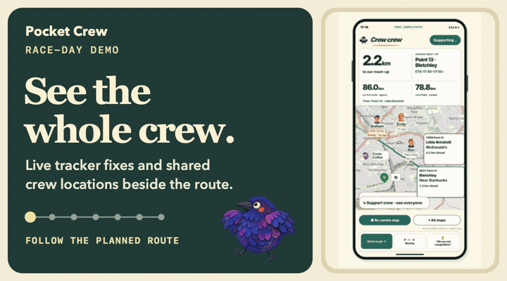

# Pocket Crew — a little crew in your pocket

Find the next meet-up, see when your runner might arrive, and check for a nearby loo. The **65-second phone walkthrough** uses sample race-day scenarios with captions, crow callouts and tap cues.

[Download the full 65-second walkthrough (MP4)](renders/Pocket-Crew-Playful-Phone-Demo.mp4?raw=true)

<a href="renders/Pocket-Crew-Playful-Phone-Demo.mp4?raw=true"></a>

## Try it

Download or clone the repository, then open [`index.html`](index.html) in your browser. No application install or tracker account is needed for this standalone demo. GitHub's file view displays the HTML source; it does not run the page.

Press **Play walkthrough**, choose a chapter, or pause and try the phone's controls. The page and the panels inside the phone scroll independently. Annotations disappear when you take control or scroll a phone panel.

The walkthrough shows finding the crew, opening the next meet-up, understanding an ETA, marking a meet-up and undoing it, filtering nearby facilities, checking runner details, replaying a milestone celebration, browsing recorded standings and following favourites. The final example explains explicit location sharing.

## What the demo uses

This is a local simulation reconstructed from the application code and supplied screenshots. It uses labelled sample states, a historical map capture, original artwork and archived race results. It does not request GPS, poll a tracker or update a real crew room. The shared-plan captions illustrate the intended guide behaviour; the demo changes only local sample state.

The approximate route distance and crow-flight metric remain distinct. Arrival windows are estimates, recorded standings are snapshots, and comparisons across race categories are informal. Historical facility access and hours need fresh checks for a future event.

## Edit or render

- `index.html` is the standalone interactive page.
- `animation.html` is the editable HyperFrames composition for the approved movie.
- `app.js` owns the scripted UI states and the 65-second clock; `coach.js` and `coach.css` own the annotation layer.
- `phone.css`, `viewer.css` and `viewer.js` provide the phone and page layout.
- `assets/` contains the original artwork, supplied map reference, copied estimate helpers and bundled dependencies.

The movie was rendered with **HyperFrames 0.8.181**, H.264, 1080×1920 at 30fps. With Node.js and FFmpeg available, run from the repository root:

```sh
npx hyperframes@0.8.181 render demo --composition animation.html \
  --quality high --fps 30 --workers 2 --crf 20 --strict \
  --frames-cache-dir off \
  --output demo/renders/Pocket-Crew-Playful-Phone-Demo.mp4
```

See [verification and limits](VERIFICATION.md) and [asset notices](assets/LICENSES.md). For a future event, use the [installable guide-building skill](../skills/README.md) and [reuse instructions](../docs/reusing-the-guide.md).
