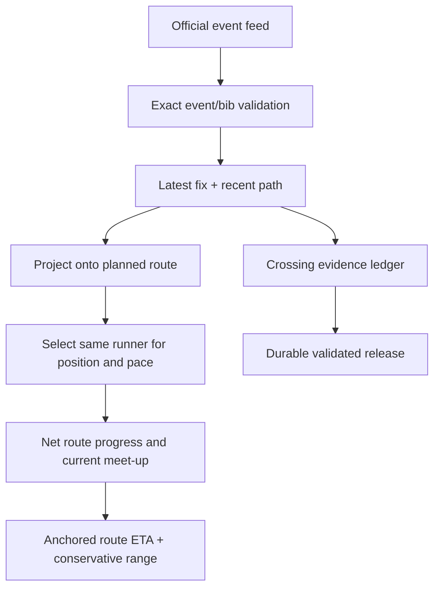

# Crow Crew technical architecture and source map

This reference describes the working **14 November 2026 v57** source, not an imagined rewrite. Preserve its contracts when adapting it for a new event; parameterize participants, category leaderboard, route, provider and auth instead of hard-coding another race. If the actual code differs, inspect and test the code before applying these notes.

## Contents

1. Runtime and build
2. Authoritative source tree
3. Data model
4. Backend contracts
5. Tracking/ETA pipeline
6. Client state, location and map
7. Milestones and posters
8. Source code inspection map

## 1. Runtime and build

- Hosting: ChatGPT **Sites**, a public mobile web Site with one existing D1 binding `DB`; Cloudflare Worker via Vinext/Next.js 16, React 19. D1 stores mutable crew room and shared award ledger. There is no R2 binding in original `.openai/hosting.json`.
- Auth: normal guide URL gives anonymous read-only access. Separate fragment capability grants publisher or location setup privileges; server stores SHA-256 hashes only. Do not conflate the display role toggle with authorization.
- Source HTML: edit `guide/index.html`, not generated `public/index.html`; `scripts/prepare-guide.mjs` copies source and renders `guide/poster-home.html` through `guide/poster-template.mjs` to `public/poster/index.html` before build. Root route `app/route.ts` serves guide; `/poster` is optional stylistic display sharing the same JS/data/room.
- Styling: `public/style.css`, `public/map-first.css`, `public/poster-view.css`, `public/intro/*`; main and alternate design driven by the same data.
- Development: `npm run install:ci` (locked install); `npm run dev` (Vinext); `npm run build` (prebuild copies guide); `npm run start` (built Worker/Wrangler local D1); `node --test tests/*.test.mjs`. Follow the current Sites skill for managed preview and safe publish; its rules may evolve.
- Persistence: `db/schema.ts`, generated `drizzle/0000_flimsy_betty_ross.sql` and `drizzle/0001_shiny_ravenous.sql`. Do not edit applied migrations. The `crew_rooms` table is primary shared state, `toilet_routing_cache` is a distinct single-row routing cache/lease. Preview D1 is not production D1.

## 2. Authoritative source tree

| Concern | Authoritative files | Why it matters |
|---|---|---|
| App shell, role switch, notes, offline saves | `guide/index.html`, `public/app.js`, `public/style.css` | Phone-first layout, local preferences, no backend data overwrite |
| Main map and person sheets | `public/map-first.js`, `public/map-first.css` | Leaflet/OSM, labels, follow, layers, individual actual/inferred pins |
| Meeting selection/updates | `public/support.js`, `public/upcoming-points.js`, `public/crew-travel.js` | Confirmed / skipped / alternate stops and travel helpers |
| Live tracker and browser GPS | `public/live.js`, `app/api/tracker/route.ts` | Visible-page polling and supporter opt-in sharing |
| Pace and ETA | `public/arrival-eta.js`, `public/meeting-forecast.js` | Actual route progress and conservative arrival range |
| Achievements | `lib/race-milestones.ts`, `public/race-milestones.js`, `public/race-moments.js` | Crossing evidence, history, previews and no false unlocks |
| Posters and animation | `public/celebrations.js`, `public/poster-view.js`, `public/data/poster-manifest.json`, `public/assets/surprises/` | Distinct artwork, hidden future cards, replay |
| Shared crew state | `app/api/crew/route.ts`, `lib/crew-room.ts`, `lib/public-crew-config.ts`, `db/schema.ts` | D1, capabilities, CAS updates, expiry, shared source of truth |
| Toilets/EV/cafés | `public/data/facilities.json`, `public/toilet-hours.js`, `public/crew.js`, `app/api/toilet-arrivals/route.ts`, `lib/toilet-routing.ts` | Verified stops, hours uncertainty and optional driving ETA |
| Intro | `public/intro-host.js`, `public/intro/great-escape-intro.js`, intro assets | Skip/replay/pause/reduced-motion; map stays active |
| Offline | `public/sw.js`, `public/app.js` | Versioned caches; guide offline, live feeds online-only |
| Historical route + stops | `public/data/route.geojson`, `route-full-2025.geojson`, `support-points.json`, `guide-data.json`, `milestone-route.json` | Projection, official award vs route km, provenance |
| Optional rival | `public/rival.js` | Separate official-bib GPS/pace, never feeds primary runner ETA; 2026 Matt #210 |
| Category standings and user follows | `app/api/leaderboard/route.ts` re-exporting `GET_LEADERBOARD` in `app/api/tracker/route.ts`; `public/competitors.js`, `public/competitors.css`; map integration in `public/map-first.js` | Category-specific provisional crow-flight standings, optional informal all-category comparison and per-phone custom competitor follow/map visibility without ever touching crew room or ETA |
| Poster-themed display | `guide/poster-home.html`, `guide/poster-template.mjs`, `public/poster-view.js`, `public/poster-view.css` | Alternative skin without parallel state |

### Data files in more detail

`public/data/support-points.json` has `schemaVersion`, source provenance/checked date, `planningEndKm`, `goldCrossingKm`, `confirmedPassedPointIds`, count summaries and **groups**. Each group has stable `id`, displayed `number`, label, routeKm / routeKmEnd, `optionIds`, `groupingBasis`, `options`, `town`, `beyondPlannedFinish`. Options have stable `id`, original point number/name/coordinates, actual lat/lng, projected routeKm, `routeOffsetM`, `detail`, `kind`, source URLs, `town` and a `landmark` with `name`, `mapLabel`, `nearbyLabel`, `meetingNote`, `sources`, `checkedOn`; EV candidates additionally carry `optionalMeetup` / `evAddedOption` / `facilityId`. Distinguish approved meeting options from historical route cues and distance placemarks.

`public/data/guide-data.json`: award origins, source details, route distance and stop cards, timing assumptions, uncertainty descriptions, projected gold and planned endpoints. `milestone-route.json`: route geometry with source checksum for achievement projections. `route.geojson`: line visible/used by current plan. `route-full-2025.geojson`: original onward historic route to support extension. `facilities.json`: researched WC, charging, café/service venue with operator/source/hours confidence.

`public/data/poster-manifest.json`: milestone ID → `{preview,download,width,height}`. Current IDs include `start`, `marathon`, `km-50`, `km-60`, `km-70`, `km-80`, `km-90`, `km-100`, `gold`, `km-110`, `km-120`, `km-123`. The poster/achievement ID vocabulary must agree across frontend, backend, assets and tests.

## 3. Shared D1 state

`crew_rooms` keyed by `view_hash` with `publish_hash` unique, `created_at`, `expires_at`, `updated_at`, legacy `sharing`, latest `lat/lng/accuracy/position_updated_at/position_recorded_at`, `bib`, `meetup_json` and optional legacy `google_maps_url`. Its JSON envelope contains current meet-up, celebrations, per-person supporters, supporter walking plans, checkpoint statuses/receipt/selected point, optional EV selection and race achievement ledger. **Only the latest location** is retained; no track history.

The public event uses fixed `PUBLIC_CREW_VIEW_HASH`, `PUBLIC_CREW_PUBLISH_HASH`, optional distinct `PUBLIC_CREW_LOCATION_HASH`, and `PUBLIC_CREW_EXPIRES_AT`; these are runtime settings, not code constants or user-visible strings. Hash raw high-entropy random capability values with SHA-256; store raw codes only with authorized crew privately. Do not reuse original tokens. A configured public room cannot be listed or recreated by anonymous viewers. The public room can be activated idempotently and expires absolutely, not extended by reuse. Revocation/expiry scrub shared state and retain a tombstone.

### Capability separation

| Role/capability | View | Modify official runner? | Update supporter phone fix / plan | Select/mark stops | Release posters | Revoke |
|---|---|---|---|---|---|---|
| Anonymous guide visitor | Public guide, already-released moments | No | No | No | No | No |
| Supporting display toggle only | Same data + planning UI | No | No | No | No | No |
| `#support=` publisher | Yes | Only existing permitted admin config, not fabricate tracker | Yes, with explicit GPS | Yes | Only validated server-controlled release path | Yes |
| `#locate=` or recovery location grant | Yes | No | Yes, designated person | Validated checkpoint actions on known points | No | No |
| Official tracker adapter | Sanitized public runner data | Read-only external | No | No | Candidate achievement persisted by validated ledger | No |

Do not expose tokens on public share links or in returned JSON. The server returns `Cache-Control: private, no-store`, noindex headers, strips unauthorised fields, rate-limits creation, validates exact request keys and positions; client strips invitation URL fragment after activation.

## 4. Backend API contracts

### `GET /api/tracker?bib=<exact bib>`

The adapter is pinned to a **specific event ID, slug and date**, uses exact bib matching and rejects wrong/ambiguous event or number. Current upstream `track.trail.live` uses `/event/{id}`, `/event/{id}/participants` and `/event/{id}/participants/{participantId}/path`. Historical values: 2026 event `35950`, target bibs `247` / `133`; **replace all**. Public JSON exposes sanitized participant location/status and bounded recent/pace/achievement reports—not secrets or unbounded raw payloads. Metadata cache ~5 min, roster ~30 s, path fetch bounded ~8 s, whole request budget ~13 s; GPS path report `recordedAt` is used for pace, **not** HTTP delivery or provider `sendTime`. Recent progress window 20 reports/20 min; pace window 120 reports/120 min. Pace-history failure must not suppress otherwise-valid latest location.

### `GET /api/leaderboard?follow=210,56&category=all` — separate read-only category feed

- Uses **the same event validation and 30-second participant roster cache** as `/api/tracker`, without fetching every entrant's `/path`. No extra D1 writes or permissions. User-supplied follow bibs are numeric, exact, sanitized and capped at eight; duplicate bib records are excluded as ambiguous.
- Official roster fields `group=Solo`, `ageCategory=F` define Emily's female solo category (36 entries in a 14 November 2026 snapshot; expect a variable count for future races). `routes[0].dist` is official **crow-flight distance** from the event origin, *not* actual on-foot route distance or recent running pace. Female solo array sorted decreasing by crowKm with provisional ordinal rank. Entire public name/bib/category roster lets viewers search any entry; `followed` contains requested competitors' sanitized positions/statistics.
- Output: `status`, `event`, `checkedAt`, `metric:'crow-flight-km'`, `femaleSolo`, `allCompetitors`, `roster`, `followed`, `message`. The `category` query must be one of `female-solo`, `male-solo`, `pair`, `chained`, `other`, `all` (default female-solo) and determines which up-to-eight fresh participants can get optional moving-pace path reads. `allCompetitors` is an overall crow-flight-sorted **informal** comparison across categories; each participant includes `hasValidLocation` but **never bulk-exposes other entrants' lat/lng**. Explicit followed entries and original `femaleSolo` may expose validated `lat`, `lng`, `updatedAt`, `crowKm`, `finished`, `retired`, `name`, `bib`, `group`, `ageCategory`; their GPS is subject to original age. No tracker/device IDs, path, extra organiser fields, average speed, private room or capability tokens. `Cache-Control: private, no-store`.
- Inactive or mismatched event never returns historical location records; provider failures return unavailable with a bounded retry. Wrong event cannot be papered over by old cached client positions. Compare report ages before presenting any personal location as current.

### `/api/crew`

- `GET ?public=1`: anonymous read of just the designated public room, with `waiting` / `active` / `ended`; no unreleased schedule or credentials.
- `POST action=activate-public`: authenticate publisher capability; `activate-location`: authenticate separately configured limited location grant; legacy `create` creates a private room with its own TTL. Invalid capability does not create or overwrite room.
- `PATCH`: distinct payloads for latest named supporter `personId` plus `position`/`sharing`, `supporterPlan: {personId,mode}`, `checkpoint: {action,pointId}`, agreed meet-up, bib/compatibility settings, validated celebration (not a location shortcut). Validate `position` lat/lng/accuracy/recordedAt and action/ID whitelist.
- `DELETE`: publisher-only revocation. Location grants cannot revoke, change arbitrary coordinates, release celebration, or extend expiry.
- Security: max request body 8 KB; fresh phone recordedAt no older than 2 min, no more than 30s future; position update must not regress previous timestamp. Independent named supporter state, CAS updates preserving unrelated fields. New private rooms default to 48h; public expiry is explicitly configured for event.

### `POST /api/toilet-arrivals`

Accept only validated IDs of curated toilets, and a shared crew origin newer than five minutes. One batched OSRM/FOSSGIS driving matrix (no direct browser geolocation request). Deduplicate and 5-min cache near-identical requests; isolate-wide plus D1 `toilet_routing_cache` lease, provider ~1.1s gap. If provider/D1 unavailable, fail closed—never substitute crow-flight drive times. Display parking/walking allowance separately. Browser limits requests to approximately one per two minutes while the WC view is visible.

### Other routes

`app/route.ts` root HTML, `app/poster/route.ts` alternative shell, `app/crew-location/route.ts` redirects old crew-location URL to new in-site panel. Never create independent state for alternate shell.

## 5. Tracking-to-ETA flow

- Position freshness and precision checked before pace. Discard stale, future, invalid, off-route (>=500m) or impossible jumps. A current position may display with **no ETA** if moving history is insufficient.
- Select the most recent actual GPS fix that also has usable route pace; if not available, select newest usable position, explicitly say waiting. If multiple runners, fallback to other runner only when its own location and pace are both valid, and name that source. An individual person's card never borrows the other runner's fix.
- Derive moving pace from time-ordered, plausible route-projected GPS. A verified >=2-minute stationary stretch of <=20m route progress ends the old pace window; after resumption require two forward intervals (>=2min and >=80m) before fresh moving pace is accepted. A >5min GPS report gap also starts a fresh window. A currently stopped runner cannot keep an expired moving pace. When path history is temporarily sparse and there is **no confirmed stop**, `carryPace` may hold the runner's own previously measured route pace provisionally for a bounded time (reconstructed from <=120min source history); never use organiser's average crow-speed or a preplanned speed. Reject impossible/erratic progress.
- Estimate `recordedAt + routeDistanceRemaining/currentRouteSpeed`; do not add full remaining travel time to time of poll. Round carefully, using `Europe/London`; historical positions cannot slide ETA later simply because a viewer refreshed.
- Meeting forecast creates **earliest unchanged-pace** and **later conservative slowdown** (5% more min/km per future hour, optionally capped at 15%/hour based on validated trend; maximum 1.5× current min/km). Long range rounded to 15 min and short to 5 min. This is planning range, **not** a statistical confidence band and may be beaten by faster movement. No mandatory “Be ready by” banner.
- Original event award: 30/60 miles as the crow flies from organiser's origin, not 50/100 route km. `lib/race-milestones.ts` defines `marathon`, `silver`, `gold` and additional route-km milestones. Poster release demands corroborating plausible GPS fixes across threshold and successful durable persistence.

## 6. Client state and map

- `public/live.js` owns `window.liveGuide`, fetching visible-page runner/tracker and D1 snapshots. Methods include `getSnapshot`, `refresh`, `setSupporterPlan`, `selectCheckpoint`, `completeCheckpoint`, `skipCheckpoint`, `undoCheckpoint`, `addEvMeetup`, `removeEvMeetup`, `pendingReleases`, `acknowledgeCelebration`, `showCrewLocationControls`.
- `public/map-first.js` owns `window.raceMap`: `focusPoint`, `focusPerson`, `follow`, `everyone`, `showNextPoints`, `showFullRoute`, `showToiletsAhead`, `showChargers`, `openPoint`, `getUpcomingPoints`, `getMilestones`, `showMilestones`, filters. Keep initial map usable before optional intro loads.
- `public/competitors.js` owns `window.competitorGuide` (getSnapshot, follow, unfollow, setShown, isShown, setFemaleSoloMap [legacy OFF-only compatibility], setLeaderboardCategory, setCompareOverall, open, isFresh, refresh). Poll every ~45s while visible; event-specific `crow-competitors-35950-v1` localStorage holds default Matt #210, maximum eight follows with independent Map booleans, selected leaderboard category and informal overall toggle; old category-map ON preferences are overridden OFF. On outage keep original participant times, not poll times. **Both `guide/index.html` and `guide/poster-home.html` expose the same “We are not competitive” dedicated bottom-dock tab**; neither floating category/leaderboard controls nor a map legend or tracker-age chip remain on the map. Within the leaderboard sheet, `#leaderboard-category` selects Female solo/Male solo/Pairs/Chained/Other; `#leaderboard-overall` temporarily compares Emily with **all entrants**, using a highlighted rank card and a full labelled list. `#leaderboard-podium` uses the chosen top three; gold/first step is visibly tallest (`200px` vs silver `157px`), Emily bib #247 is shown with `assets/avatars-v5/emily.webp` instead of a crow if present and animates without lifting silver above gold. The family-selected followed cards retain status badges and individual Map toggles; **only followed-and-enabled entrants** can appear on `rivalLayer`, with old GPS as a faded labelled last-known pin. Old category preferences cannot render extra people. Confirmed `retired`/`finished`, >60min likely-out, fresh/stale entered states are styled distinctly. Neither category nor followed coordinates enter route follow/ETA calculations.
- Display names, avatar cutouts and status strips are same in both shells. Runners' positions from official feed; supporters from their separate, explicitly shared phone fix; **walking-with-runner plan** may infer display placement at the *fresh* named runner coordinate and must say that clearly. Does not mutate true phone fix.
- Local browser keys for preferences, first-view intro, moments seen and optional support capability are event-specific; rename them in new event. Settings `Update / reload guide` refreshes shell without restarting sharing. Service worker cache is versioned and deliberately avoids APIs, token-bearing URLs or future poster images.
- `public/sw.js` v61 precaches `competitors.js` and `competitors.css` alongside the guide shell but **not** live `/api/leaderboard`; offline mode may show aged previously loaded standings in memory, not imply live updates. Milestone cards compute dual-distance labels using `routeKm` and `crowKm`; installed crow home-screen artwork has consistent red-background SVG and 180/192/512 PNG.
- Map tiles are external OSM; cache normally through browser, not wholesale offline prefetch. Directions / drive-to-pin launch maps with a selected point. Support stop pin info carries `town`, landmark and note. A purely interpolated route milestone does not become a car meet-up.

## 7. Milestones/history

The frontend has an achievements timeline / “Moments & milestones”. Items show achieved status, estimated crossing time and evidence details; unreached runner sees no future poster preview. Saved historical crossings are replayable and are **not reannounced** on reload. An intro or visible modal postpones new celebration display; after several missed releases, only the latest may auto-open, but all earned posters remain in history. A preview card links “Enjoy this moment again ♡”, not a duplicate “Open posters”. `public/celebrations.js` adds finite crow/heart/toast/crown motion with reduced-motion fallback.

## 8. Inspect the code before changing a contract

Use targeted `rg -n` on definitions and tests. High-risk tests: `tests/crew-room.test.mjs`, `tracker.test.mjs`, `leaderboard.test.mjs`, `competitors.test.mjs`, `live-bridge.test.mjs`, `arrival-eta.test.mjs`, `map-first.test.mjs`, `meeting-forecast.test.mjs`, `race-milestones.test.mjs`, `celebrations.test.mjs`, `race-moments.test.mjs`, `runner-views.test.mjs`, `offline-updates.test.mjs`, `toilet-arrivals.test.mjs`, `support-point-descriptions.test.mjs`. Full suite and manual verification in [validation.md](validation.md). The supplied historical notes report 478 automated tests passing for v57 on 14 November 2026; this skill release does not reproduce that result.
